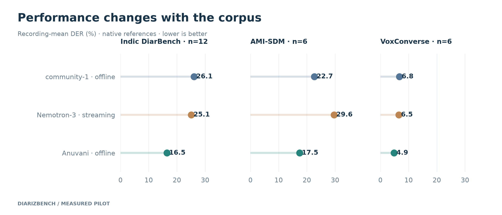
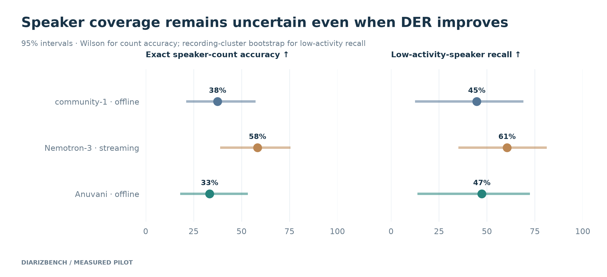
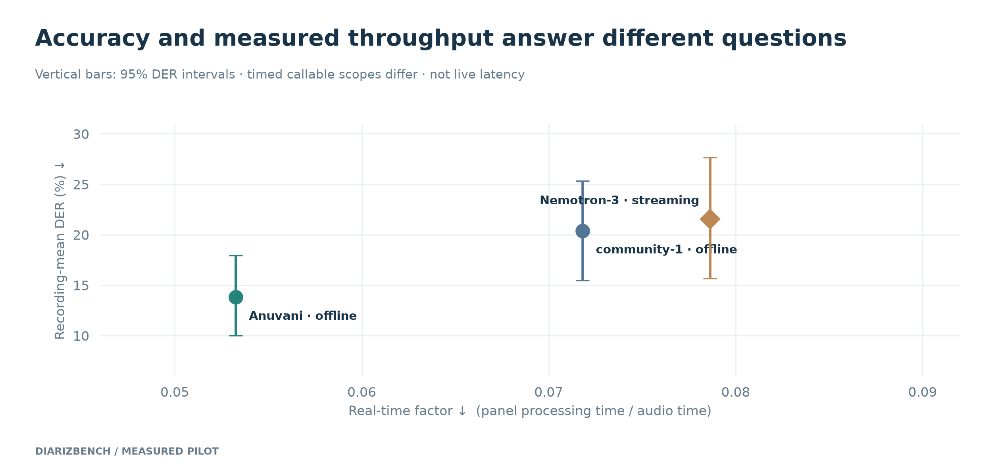
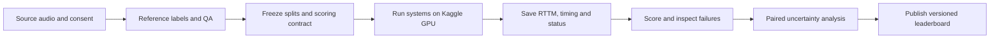
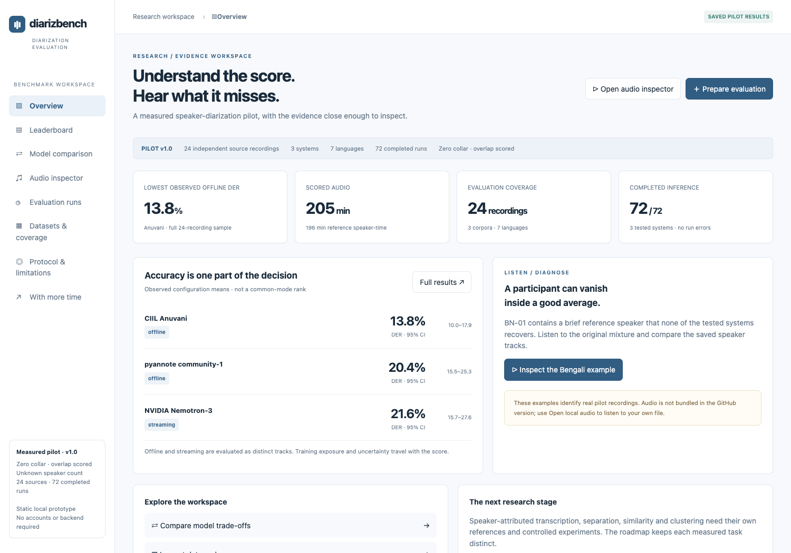
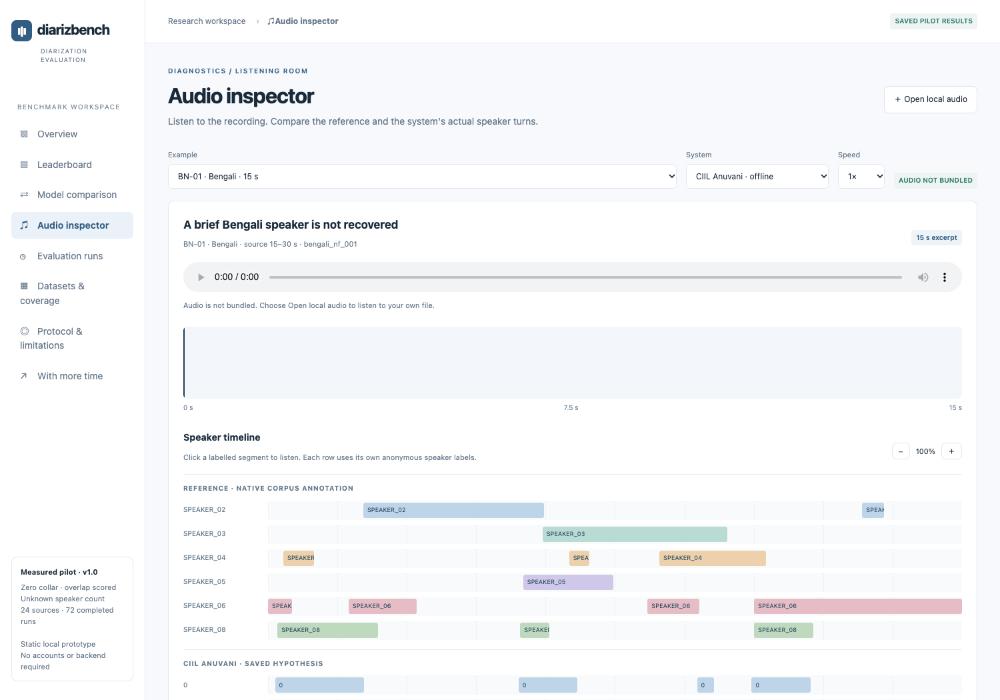
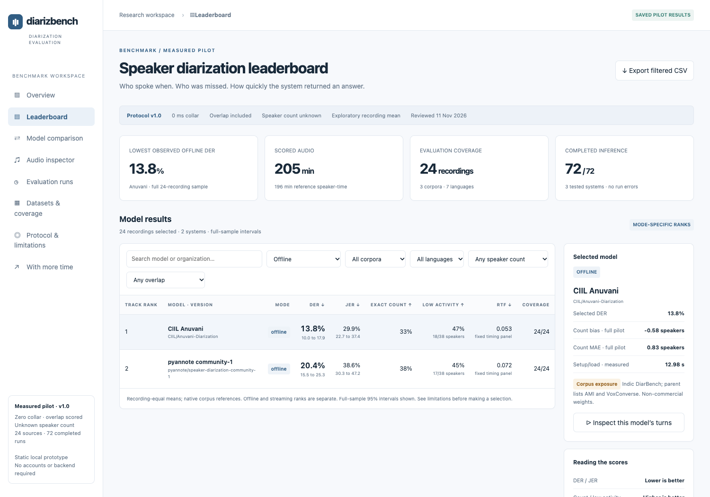

<div align="center">

# DiarizBench

### Who spoke when. Who was missed. What the score hides.

A reproducible speaker-diarization pilot and a proposed methodology for a multilingual product leaderboard.

**24 source recordings · 7 languages · 3 systems · 72 completed inference units**

[Methodology](docs/METHODOLOGY.md) · [Kaggle notebook](kaggle/diarizbench_pilot.ipynb) · [Results](#measured-pilot) · [Product design](#product-design)

</div>

---

Diarization identifies **who spoke when**. A useful benchmark also asks whether a brief participant
survives, whether overlapping voices are handled, and what workload a speed number measures.
DiarizBench combines those questions with frozen scoring rules, recording-level evidence,
uncertainty estimates and an inspectable leaderboard design.

This repository contains **completed pilot evidence** and a **proposed production methodology**.
The pilot is not a universal model ranking. The proposed 60-hour collection and additional research
tracks have not been executed.

**No audio is committed to GitHub, including embedded audio in the public HTML.** Obtain source
data separately or use a local file in the design's listening room. Dataset sources are documented
[below](#datasets) and in [docs/DATA.md](docs/DATA.md).

## Measured pilot

All systems were scored on the same 24 recordings with unknown speaker count and overlapping speech
included. The headline is an equal-weight recording mean; cross-corpus aggregates are exploratory
because the native annotation conventions differ.

| System | Mode | DER ↓, 0 collar (95% CI) | DER ↓, c=0.25 s | JER ↓ | Exact count ↑ | Low-activity recall ↑ | RTF ↓ |
|---|---|---:|---:|---:|---:|---:|---:|
| [CIIL Anuvani](https://huggingface.co/CIIL/Anuvani-Diarization) | Offline | **13.8 [10.0, 17.9]** | 10.3 | 29.9 | 33% | 47% | 0.053 |
| [pyannote community-1](https://huggingface.co/pyannote/speaker-diarization-community-1) | Offline | 20.4 [15.5, 25.3] | 16.7 | 38.6 | 38% | 45% | 0.072 |
| [NVIDIA Nemotron-3](https://huggingface.co/nvidia/Nemotron-3-Diarization) | Streaming | 21.6 [15.7, 27.6] | 18.8 | 32.5 | **58%** | **61%** | 0.079 |

DER/JER are percentages; lower is better. Count/recall are percentages; higher is better.
The local `pyannote.metrics c=0.25` setting excludes **125 ms on each side** of reference boundaries.
Zero collar stays primary. RTF comes from the fixed six-recording timing panel, with setup/load
separate; timed callable scopes differ, so it is not a matched end-to-end service-latency comparison.

- Anuvani has lower observed DER than community-1 in the matched offline comparison.
- Nemotron is a separately configured streaming result and has no shared offline rank.
- Non-significance does not establish equivalence. Counting/coverage gaps are descriptive.
- Public-corpus training exposure, two recordings per Indic language, the structural-only reference
  audit and incomplete immutable weight/environment capture limit generalization and exact reruns.

### Performance depends on the corpus



The observed ordering is consistent across these samples, but margins change by corpus.
Content, overlap, participation and reference conventions are confounded; these plots do not isolate causes.

### Speaker coverage belongs next to DER



The low-activity diagnostic identifies reference speakers with at most 5% of speaker-time and at
least 0.5 seconds of speech. Recovery requires at least 50% coverage by a one-to-one matched
hypothesis. This is a proposed diagnostic, with sensitivity analysis in the report.

<details>
<summary><strong>Accuracy and measured throughput</strong></summary>



Load/setup, inference-call scope, hardware and operating mode are part of the result. A lower RTF
does not by itself establish better live latency or a better production service.

</details>

## Methodology



The [main report](docs/METHODOLOGY.md) specifies audiences and decisions, a 12-system comparison catalog,
a proposed **60-hour development/evaluation collection**, annotation/adjudication, DER/JER and
coverage metrics, fairness rules, significance testing, operating tracks and reference versioning.

The production collection is proposed: 12 public development hours and 48 private evaluation hours,
four domains with English/Indic balance and six Indic languages. Future research includes
cpWER/tcpWER, more diverse datasets, speaker separation, similarity/verification, clustering,
VAD/SAD and controlled component ablations. These are not presented as completed evaluations.

## Repository map

| Path | Purpose |
|---|---|
| [`kaggle/`](kaggle/) | Importable GPU notebook, loaders, smoke test, full pilot and timing panel |
| [`harness/`](harness/) | Manifest, RTTM handling, DER/JER/coverage scoring and validation fixtures |
| [`scripts/`](scripts/) | Data preparation, output collection, analysis, figures and report/design builders |
| [`data/references/`](data/references/) | Selected source reference annotations; original dataset terms apply |
| [`data/hypotheses/`](data/hypotheses/) | Saved model RTTMs; no audio |
| [`data/runs/results/`](data/runs/results/) | Per-recording scores, bootstrap statistics and uncertainty |
| [`data/runs/timing/`](data/runs/timing/) | Timing evidence and panel summaries |
| [`docs/main.md`](docs/main.md) | Final benchmark methodology, measured findings and reflections |
| [`docs/assets/`](docs/assets/) | Report graphs and product screenshots used here |
| [`submission/`](submission/) | Main PDF, one-page PDF, sketch PDF and audio-free HTML design only |
| [`third_party/dscore/`](third_party/dscore/) | Independent reference scorer with its original license |

Planning and research notes in the repository root record design history. The final report and saved
result JSON are the current evidence; a planned experiment is not a measured outcome.

## Run locally: scoring and analysis

Python **3.11** is the tested local scoring environment. The CPU tools do not download model weights.

```bash
git clone https://github.com/ayushk1233/DiarizBench-.git
cd DiarizBench-
python3.11 -m venv .venv
source .venv/bin/activate
python -m pip install -r requirements.txt

# Validate the scorer and Kaggle checkpoint contract; no GPU or audio required.
python -m pytest harness/test_scoring.py tests/ -q

# Re-score the committed hypotheses at both collar settings.
for model in community-1 nemotron anuvani; do
  python scripts/t09/score.py --system "$model"
  python scripts/t09/score.py --system "$model" --collar 0.25
done

# Recompute exploratory analysis and redraw the report figures.
python scripts/t11/statistics.py
python scripts/t12/uncertainty.py
python scripts/t14/build_figures.py

# Build an audio-free product preview; no corpus downloads needed.
python scripts/t14/build_frontend.py --no-audio
```

Published scores are saved evidence. Use a separate clone or experiment branch when generating new
results: these scripts write to the canonical result paths. Exact historical inference cannot be
guaranteed because complete immutable checkpoint/environment locks were not captured.

Report PDF builders additionally use Google Chrome and macOS fonts in the original environment.
The committed PDFs are ready to read. Rebuilding the full private listening demo or audio-inspector
PDF page requires the separately obtained canonical audio.

## Run inference on Kaggle GPU

The notebook is the GPU entry point; local tools prepare data and analyze its outputs.
You do not need a local GPU.

### 1. Prepare your input

Obtain the recordings listed in [`harness/manifest.json`](harness/manifest.json) from the original
datasets. Use the optional [data-preparation workflow](docs/DATA.md) or supply permitted 16 kHz mono
WAVs named by manifest ID. Create your own private Kaggle input dataset and attach it to the notebook.
**The author's private audio dataset is not shared through this repository.**

### 2. Import and configure the notebook

1. Download [`kaggle/diarizbench_pilot.ipynb`](kaggle/diarizbench_pilot.ipynb), create a
   [Kaggle notebook](https://www.kaggle.com/code/new), and use **File → Import Notebook**.
2. Enable a GPU accelerator (the measured pilot used **Tesla T4 ×2**) and Internet access.
   Available GPU types/quota depend on your Kaggle account.
3. Add your canonical audio dataset as a notebook input.
4. Accept the [community-1 access conditions](https://huggingface.co/pyannote/speaker-diarization-community-1),
   then add a Kaggle Secret named **`HF_TOKEN`** and enable it for the notebook. Never paste tokens
   into notebook cells or publish them in outputs.

The clone cell already points to this GitHub repository and prints the checked-out commit. If several
inputs contain WAVs, set the intended directory before the run:

```python
import os
os.environ['DIARIZBENCH_AUDIO_DIR'] = '/kaggle/input/YOUR-AUDIO-DATASET'
```

### 3. Execute in order

Run clone/update → token check → dependency installation → smoke test → full pilot → timing panel.
Review the smoke output before running the full pilot. The runner checks the 24 expected filenames
and checkpoints each system/recording pair. It resumes only a non-empty RTTM with successful JSON
metadata; incomplete units are retried.

The notebook uses these scripts:

```python
import smoke_test
smoke_test.main()

import run_pilot
run_pilot.main()

import timing_panel
timing_panel.main()
```

Download `diarizbench_output.zip` and, if run, `timing_output.zip` from `/kaggle/working/` in the
notebook's output/files panel. Save a notebook version to retain outputs; Git does not persist the
Kaggle working directory. The new timing wrapper includes final model-output processing, whereas
the historical Nemotron panel returned logits: report rerun timings as a new experiment, not a
silent replacement of the published timing scope.

### 4. Bring outputs back locally

```bash
# Inspect the incoming recordings before changing the local run state.
python scripts/t09/merge_output.py --zip /path/to/diarizbench_output.zip --dry-run
python scripts/t09/merge_output.py --zip /path/to/diarizbench_output.zip

# Score and analyze as shown in the local workflow.
python scripts/t09/score.py --system community-1
```

Full optional CLI orchestration is in [`scripts/t09/README.md`](scripts/t09/README.md).
[Kaggle notebook documentation](https://www.kaggle.com/docs/notebooks) covers account/setup details.

## Datasets

| Dataset | Pilot use | Source |
|---|---|---|
| Indic DiarBench | 12 recordings; Hindi, Bengali, Marathi, Tamil, Telugu and Kannada | [Sarvam AI dataset](https://huggingface.co/datasets/sarvamai/indic-diarbench) |
| AMI Meeting Corpus | Six English distant-microphone meetings | [Official corpus](https://groups.inf.ed.ac.uk/ami/corpus/) |
| VoxConverse | Six English-tagged development recordings | [Official project](https://github.com/joonson/voxconverse) |

Audio is excluded from Git and must be obtained under the original dataset terms. Reference
annotations retain their source terms and attribution; see [data documentation](docs/DATA.md).
Model licenses also differ: Anuvani/DiariZen weights have non-commercial terms. This repository's
public availability does not remove dataset or checkpoint restrictions.

## Reports and core deliverables

- [Main report](submission/Ayush_Kumar_Q1_Main.pdf): methodology, findings, limitations and final reflections.
- [One-page summary](submission/Ayush_Kumar_Q1_OnePager.pdf): setup, decisions, result and collar comparison.
- [Leaderboard sketch](submission/Ayush_Kumar_Q1_Leaderboard.pdf): results, detail, governance and audio-room design.
- [Interactive design, no bundled audio](submission/Ayush_Kumar_Q1_Leaderboard_Design.html).

Submission ZIPs, private listening HTML, intermediate renders, local review checklists and
credential-bearing execution wrappers stay out of Git. The required walkthrough video is pending
and no placeholder URL is presented as a finished deliverable.

## Product design

The design turns benchmark evidence into an inspectable product: **overview, leaderboard, model
comparison, audio inspector, evaluation runs, datasets, methodology and a future-work roadmap**.
Filters operate on saved recording scores; run inspection shows actual pilot metadata. Preparing a
configuration downloads JSON and does not pretend to launch GPU inference.

**[Download the public HTML design](submission/Ayush_Kumar_Q1_Leaderboard_Design.html)** and open it in
a browser, or use VS Code's HTML preview. GitHub displays HTML source rather than running it inline.
The GitHub version has **no embedded audio**. Turn timelines and source attribution remain visible;
reviewers can choose their own local audio for unscored playback. Separation and similarity are
future research tracks, not fabricated outputs in the demo.

| Overview and evidence | Listening-room design |
|---|---|
|  |  |

<details>
<summary><strong>Full leaderboard view</strong></summary>



</details>
